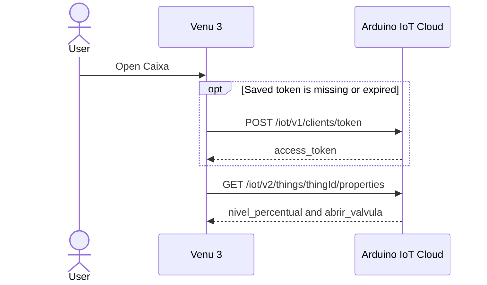
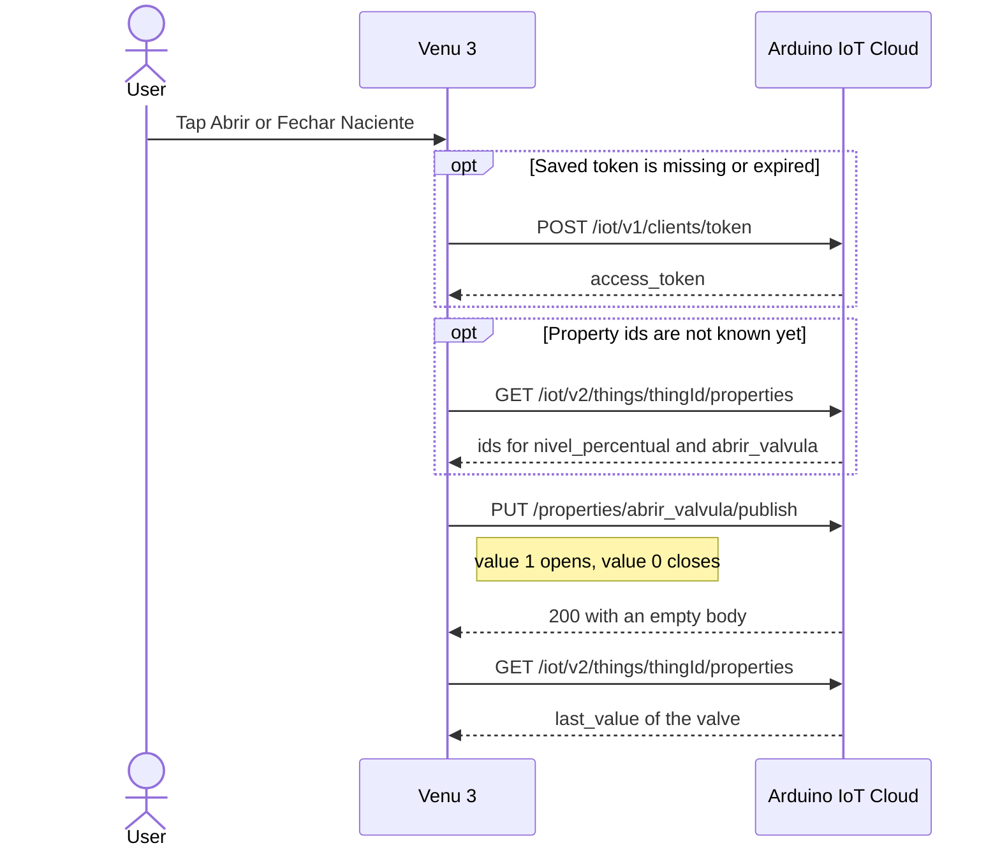

# Caixa — Garmin Venu 3

Personal Connect IQ app for a Venu 3 or Venu 3S. It shows the tank percentage and toggles the Naciente valve. The watch talks to Arduino IoT Cloud through the phone. The sketch is unchanged: the app reads `nivel_percentual` and writes `abrir_valvula`, the same variable as the cloud dashboard.

Opening Naciente from the watch is a manual open. The valve stays open until you close it, or until the sketch safety-closes at 98%. The 52% auto-close runs only when the sketch itself opened the valve.

The phone must be nearby with Garmin Connect Mobile connected over Bluetooth. If it is not, the app keeps the last reading and shows `sem telefone`.

The glance shows that saved percentage and does not use the network.

## Cloud calls

Every call leaves the watch through Garmin Connect on the phone. The watch sends only one request at a time, and waits about 100 ms before the next one. A tap outside the Naciente label sends nothing. The upper button repeats the open sequence.

Opening Caixa reads the tank. The token call runs only when the saved token is missing or close to expiring.



Tapping **Abrir Naciente** or **Fechar Naciente** writes the valve, then reads the properties again. The body is `{"value": 1}` to open and `{"value": 0}` to close. The extra property read is skipped when the app already knows the property ids from the open.



## Cloud credentials

1. In [Arduino Cloud](https://app.arduino.cc/), open the Thing and copy its Thing id. That id is not `DEVICE_LOGIN_NAME` from `thingProperties.h`.
2. Create an API client (client id and client secret) for this account.
3. Copy the example secrets file and fill it in:

```bash
cp source/Secrets.mc.example source/Secrets.mc
```

`source/Secrets.mc` stays out of git.

4. Check the property names from this machine:

```bash
./scripts/list-properties.sh
```

The script must list `nivel_percentual` and `abrir_valvula`. The app matches either `variable_name` or `name`.

## Build

Install the Connect IQ SDK from the SDK manager. The Venu 3 uses API level 5.2. Generate a developer key once and keep it. A new key makes the watch treat the next install as a different app.

```bash
openssl genrsa -out developer_key.pem 4096
openssl pkcs8 -topk8 -inform PEM -outform DER -in developer_key.pem -out developer_key.der -nocrypt
```

Both key files are gitignored.

```bash
export PATH="$HOME/.Garmin/ConnectIQ/Sdks/<sdk>/bin:$PATH"
mkdir -p bin
monkeyc -o bin/Caixa-venu3.prg -f monkey.jungle -y developer_key.der -d venu3 -w
```

Simulator:

```bash
monkeydo bin/Caixa-venu3.prg venu3
```

## On the watch

Sideload `bin/Caixa-venu3.prg` (copy it to `GARMIN/Apps` over USB, or use the Connect IQ app). Open **Caixa**.

- The big number follows the tank LEDs: green at or above 70%, yellow from 30% up to 70%, red below 30%.
- **Naciente** is `Aberta` or `Fechada`.
- Tap **Abrir Naciente** or **Fechar Naciente**. The screen shows `enviando...` and the inlet opens or closes.
- A short press of the upper button refreshes the level. A tap anywhere else does nothing.
- Swipe right, or press the lower button, to leave the app. That does not change the valve.
